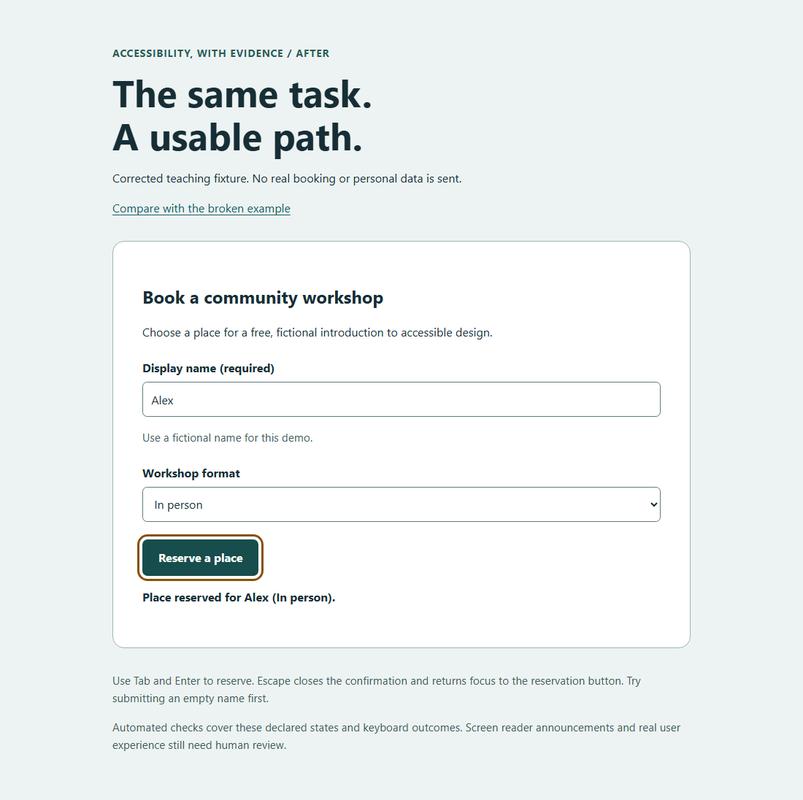

# Accessibility, with evidence

[](https://github.com/titoude/accessibilite-conformite/actions/workflows/ci.yml)

**An accessibility skill and toolkit for coding agents.** It helps an agent (or a developer) find barriers in a website or web application, fix them in source code, verify the result, and say plainly what still needs a human.

A *skill* is a Markdown file of instructions that an AI coding agent, such as Claude Code, Codex or Devin, loads to follow a defined procedure. [SKILL.md](SKILL.md) is that procedure; the scanner, checklist and test helpers next to it work just as well by hand. The target is **WCAG 2.2 A/AA** for web content.

[Use the skill](SKILL.md) · [Run the scanner](#scan-your-application) · [Try the demo](demo/README.md) · [Walkthrough](docs/PRODUCT-WALKTHROUGH.md) · [Contribute](CONTRIBUTING.md)

## What's inside

| Path | What it is |
| --- | --- |
| [SKILL.md](SKILL.md) | Instructions for a coding agent: freeze the scope, fix the source without removing features, verify independently, report open items |
| [audit.mjs](audit.mjs) | Command-line scanner built on axe-core and Playwright, with scope reports and gate-friendly exit codes |
| [checklist.md](checklist.md) | Review checklist for what automation cannot judge: keyboard tasks, screen readers, zoom, motion, media |
| [templates/](templates/README.md) | WCAG 2.2 A/AA coverage record: all 55 success criteria, each starting as `NOT_TESTED` |
| [tests-validators/](tests-validators/README.md) | Assertion helpers (`accNameMatches`, `isTrulyVisible`) and nine deliberately broken cases that weak assertions miss |
| [demo/](demo/README.md) | A broken and a corrected workshop booking form, with an automated keyboard replay |
| [hooks/pre-push](hooks/pre-push) | Optional git hook that blocks a push when the scan fails |
| [docs/](docs/) | [Release readiness](docs/RELEASE-READINESS.md) gate, [three-minute walkthrough](docs/PRODUCT-WALKTHROUGH.md) and an [example report](docs/example-report.md) |
| [integrations/devin/](integrations/devin/README.md) | Optional playbook and orchestration script for Devin |

## Quickstart

Requirements: **Node.js 22+**, **pnpm 10.34.5** and **Python 3.10+**, available as `python` on your `PATH` (the npm scripts call `python`; it serves the demo and runs the Python tests). Dependencies, including transitive ones, are locked.

```sh
git clone https://github.com/titoude/accessibilite-conformite.git
cd accessibilite-conformite
pnpm install --frozen-lockfile --ignore-scripts
pnpm exec playwright install chromium
```

On Linux, use `pnpm exec playwright install --with-deps chromium` if Chromium's system libraries are missing.

**Scan the demo.** Start the local server in one terminal:

```sh
pnpm demo
```

and run the scanner from a second terminal, in the same directory:

```sh
node audit.mjs http://127.0.0.1:4173 --urls /before.html,/after.html --states none --out a11y-audit/demo
```

`--urls` lists the pages to scan, and `--states none` declares that they have no dialogs or other dynamic states to open (the scanner requires that choice to be explicit). The command should exit with code `1`, because the broken page has violations: three rules fail on `before.html` (`label`, `select-name`, `color-contrast`) and none on `after.html`. Read the result in `a11y-audit/demo/report.md`; it looks like this [example report](docs/example-report.md). Stop the server with Ctrl+C.

**Run the test suite:**

```sh
pnpm test
```

## Scan your application

With your application running, run the scanner from this toolkit directory (it loads `playwright` and `axe-core` from the current directory's dependencies):

```sh
node audit.mjs http://localhost:3000 --states none --out a11y-audit/baseline
```

Without `--urls`, it follows same-origin links from the base URL (depth 1, at most 50 pages). Crawling does not find every screen, so list important routes explicitly.

| Option | Effect |
| --- | --- |
| `--states all\|name1,name2\|none` | **Required.** Scan the dynamic states declared in `STATES`, or state explicitly that there are none |
| `--urls /a,/b` | Scan exactly these routes (resolved against the base URL) instead of crawling |
| `--depth N`, `--max N` | Crawl depth (default 1) and page limit (default 50) |
| `--wait MS`, `--wait-for SELECTOR` | Fixed delay after load; selector that must appear, otherwise the page counts as an error |
| `--storage-state auth.json` | Scan an authenticated session (Playwright storage state). Keep this file private |
| `--keep-hash` | Keep `#` fragments, for hash-routed single-page apps |
| `--strict-incomplete` | Treat axe "incomplete" results as gate errors |
| `--out DIR` | Output directory (default `./a11y-audit`) |

| Exit code | Meaning |
| --- | --- |
| `0` | Every requested scenario was scanned with no automated violations and no execution errors. Still review incompletes and human checks |
| `1` | Automated violations found |
| `2` | Invalid configuration, navigation or execution error, or (with `--strict-incomplete`) incomplete findings |

Each run writes `report.md` (violations grouped by rule, sorted by impact), `report.json` (full axe results and metadata) and `scope.json` (the scenarios actually scanned and a scope hash to compare a baseline with a fix). These files are rewritten even when the configuration is invalid or the browser fails to start, so an old report can never pass for a new one.

### Dialogs, menus and other dynamic states

Content that only appears after an interaction is invisible to a page-by-page scan. Copy `audit.mjs` into your project (for example `scripts/a11y/audit.mjs`, with the same pinned `playwright` and `axe-core` versions as dev dependencies), declare those states in its `STATES` map before the baseline, and run it from your project with `--states all`:

```js
const STATES = {
  'settings-dialog': {
    url: origin => origin + '/settings',
    setup: async page => {
      await page.getByRole('button', { name: 'Open settings' }).click();
      await page.getByRole('dialog', { name: 'Settings' }).waitFor();
    },
  },
};
```

`--states all` with an empty `STATES` map is a configuration error (exit `2`), not a pass.

## Use the skill with an agent

[SKILL.md](SKILL.md) is agent-agnostic and uses the common skill format (YAML front matter with a name and a description). If your agent loads skills from a folder, clone this repository into it (for Claude Code, for example, `.claude/skills/accessibilite-conformite/`); otherwise, give the agent `SKILL.md` and ask it to follow it. A typical request:

> Apply this accessibility skill to our web application. Freeze the scope first, preserve all features, produce source fixes and reproducible evidence, and list every unverified criterion and assistive-technology check.

The scanner finds issues; the agent or developer writes the fixes. Judge the result by its evidence: the patch, the before/after reports and the open human checks.

## Demo

`pnpm demo` serves a [before/after workshop form](demo/README.md) on `http://127.0.0.1:4173`. Try the broken form with the keyboard, then the corrected one: submit an empty name, choose a format, confirm the reservation and close the dialog with focus restored. No real booking is made.

`pnpm test:demo` replays that task in Chromium and writes axe results and screenshots to `test-results/demo/`. It requires the three known violations on the broken page and zero violations and zero incomplete findings in the four corrected states. The corrected page was written by hand as a teaching example.

<details>
<summary>Screenshot: the corrected form after a keyboard reservation</summary>



</details>

## What the tests check

`pnpm test` runs every suite; CI runs it on Ubuntu and Windows.

| Command | Checks |
| --- | --- |
| `pnpm test:browser` | Real Chromium runs of `audit.mjs`: clean page exits `0`, unnamed button exits `1`, HTTP errors, redirects, invalid options and undeclared states exit `2`, stale reports are replaced; accessible-name helper |
| `pnpm test:validators` | The hardened checks detect all nine deliberately broken cases that weak assertions miss, and valid controls still pass |
| `pnpm test:demo` | The complete keyboard reservation, four corrected states, 320 CSS-pixel reflow and forced-colors operation |
| `pnpm test:decisions` | The Devin workflow cannot report success from contradictory or missing verification results |
| `pnpm test:parity` | The copy of `audit.mjs` embedded in the Devin workflow is identical to the source |

## Limits

- Automated scanning finds only part of the WCAG failures. Zero automated violations is not WCAG or RGAA conformance, and the test suite covers the specific failure modes listed above, not every possible defect.
- Screen-reader use (NVDA, VoiceOver, TalkBack), real browser zoom and complete user tasks still need people. [checklist.md](checklist.md) and the [criterion record](templates/README.md) keep those checks open until someone performs them. The demo itself has not yet been tested with assistive technologies by people.
- RGAA, EN 301 549, the European Accessibility Act and local laws each need their own method and applicability assessment. Native apps and documents are out of scope for the scanner.
- The skill structures an agent's work; no measured claim is made that agents produce better fixes with it than without it.
- Use the [release readiness gate](docs/RELEASE-READINESS.md) before making any accessibility claim.

## Contributing and security

See [CONTRIBUTING.md](CONTRIBUTING.md). Report vulnerabilities privately as described in [SECURITY.md](SECURITY.md). Only scan applications you are authorized to test, and never commit or share authentication states, credentials or customer data.

## AI disclosure

This project was developed with AI assistance, including Devin, Codex and Claude Code.

## License

[MIT](LICENSE).
